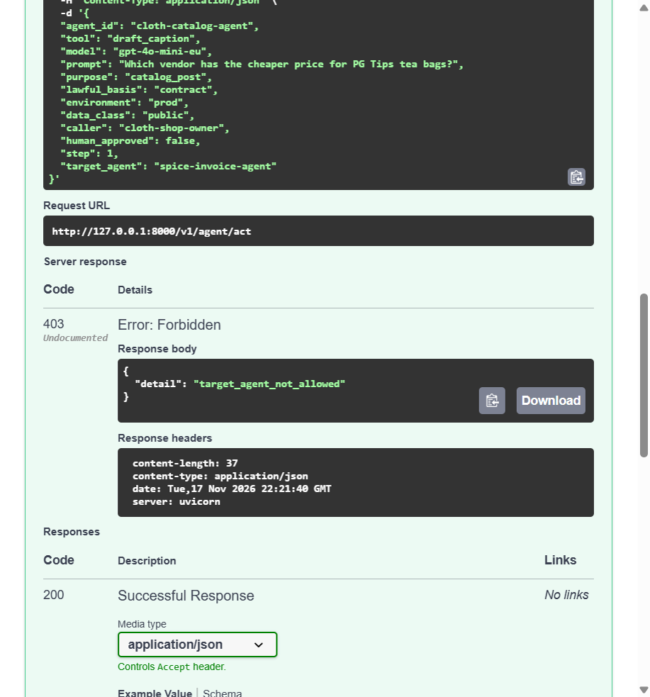

# AI Governance Gateway

[](https://github.com/affanahmed373/ai-governance-gateway/actions/workflows/ci.yml)

One controlled entry point for LLM and agent access. Every call is checked against an approved-model list and, for agents, against rules drawn from the GDPR, the EU AI Act, and the OWASP Agentic Top 10 2026. The audit log stores a hash of the prompt, not the prompt.

> Status: working skeleton. Policy, guardrails, and A2A task governance run in this process. The model call is still a stub, and `human_approved` is a declared flag, not a verified token.

History: [CHANGELOG.md](CHANGELOG.md). Latest addition: public demo on Azure Container Apps (scales to zero), with per-client rate limits and a destroy script to stop cost.

## Try it

No LLM key. Open **POST /v1/agent/act**, pick an example, Execute. The public API allows **30 requests/minute** per client and caps prompts at **4000** characters.

- Live: [https://ca-aigw-gateway.whitewave-5bd369c8.northeurope.azurecontainerapps.io/docs](https://ca-aigw-gateway.whitewave-5bd369c8.northeurope.azurecontainerapps.io/docs) (Azure Container Apps, North Europe). First request after idle takes a few seconds. Tear down: [`scripts/destroy-azure-demo.ps1`](scripts/destroy-azure-demo.ps1) ([docs/azure-demo.md](docs/azure-demo.md)).
- Local: [http://127.0.0.1:8000/docs](http://127.0.0.1:8000/docs), or [http://127.0.0.1:7860/docs](http://127.0.0.1:7860/docs) from the Docker image.

Allowed example → HTTP 200. Denied example → HTTP 403 with rule id `target_agent_not_allowed` (control matrix C-26 / ASI07):



## Showcase

Two shops share this gateway. The spice invoice agent compares supplier bills, such as which vendor is cheaper for PG Tips. The clothing store assistant answers stock and policy questions and may ask the catalog agent to draft an Instagram caption. The catalog agent cannot open the spice invoices. Deleting an invoice, and publishing the caption, each wait for a person.

The clothing-store assistant ([multi-cloud-retail-agent](https://github.com/affanahmed373/multi-cloud-retail-agent)) can send every LLM call here: set `LLM_PROVIDER=gateway` and point `GOVERNANCE_GATEWAY_URL` at this API.

| Call | Task state | Rule |
|---|---|---|
| `cloth-shop-agent` → `cloth-catalog-agent` | `TASK_STATE_COMPLETED` | `allowed` |
| `cloth-catalog-agent` → `spice-invoice-agent` | `TASK_STATE_REJECTED` | `target_agent_not_allowed` |

```bash
python -m venv .venv && source .venv/bin/activate
pip install -r requirements.txt
pytest
uvicorn app.main:app --reload
```

On Windows, activate with `.venv\Scripts\Activate.ps1`. Docker (the deployed image, port 7860): `docker build -t ai-governance-gateway .` then `docker run --rm -p 7860:7860 ai-governance-gateway`. The same check is `pytest tests/test_a2a.py::test_two_agents_one_allowed_one_blocked`.

POST both bodies to `http://127.0.0.1:8000/v1/a2a`. The rule id is `result.task.metadata.rule`. The audit line includes `caller_agent`, `target_agent`, `decision`, and `prompt_sha256`.

Allowed:

```json
{
  "jsonrpc": "2.0",
  "id": "1",
  "method": "SendMessage",
  "params": {
    "tenant": "cloth-catalog-agent",
    "message": {
      "messageId": "m-allow",
      "role": "ROLE_USER",
      "parts": [{ "text": "Draft an Instagram caption for the green waistcoat." }]
    },
    "metadata": {
      "caller_agent": "cloth-shop-agent",
      "tool": "draft_caption",
      "model": "gpt-4o-mini-eu",
      "purpose": "catalog_post",
      "lawful_basis": "contract",
      "environment": "prod",
      "data_class": "internal",
      "caller": "team-a"
    }
  }
}
```

Blocked:

```json
{
  "jsonrpc": "2.0",
  "id": "2",
  "method": "SendMessage",
  "params": {
    "tenant": "spice-invoice-agent",
    "message": {
      "messageId": "m-block",
      "role": "ROLE_USER",
      "parts": [{ "text": "Which vendor has the cheaper price for PG Tips tea bags?" }]
    },
    "metadata": {
      "caller_agent": "cloth-catalog-agent",
      "tool": "draft_caption",
      "model": "gpt-4o-mini-eu",
      "purpose": "catalog_post",
      "lawful_basis": "contract",
      "environment": "prod",
      "data_class": "public",
      "caller": "team-a"
    }
  }
}
```

Agent cards: [http://127.0.0.1:8000/.well-known/agent-card.json](http://127.0.0.1:8000/.well-known/agent-card.json) for the gateway, and `/v1/a2a/agents/spice-invoice-agent/agent-card.json` for the spice shop. Interactive API docs: [http://127.0.0.1:8000/docs](http://127.0.0.1:8000/docs).

The shops themselves stay in their own repos. This gateway only decides whether a call may run. A direct price check is `POST /v1/agent/act` with `agent_id` `spice-invoice-agent`, tool `compare_prices`, and purpose `supplier_price_check`.

### Cloth-shop chat audit log

When the retail agent uses `LLM_PROVIDER=gateway`, each answer is `POST /v1/chat`. The gateway writes one JSON audit line. The prompt is hashed; the email is masked in the response, not stored.

```bash
curl -s http://127.0.0.1:8000/v1/chat -H "Content-Type: application/json" -d "{
  \"model\": \"gpt-4o-mini-eu\",
  \"prompt\": \"Do you ship the green waistcoat to Berlin? mail me at buyer@example.com\",
  \"environment\": \"dev\",
  \"data_class\": \"internal\",
  \"caller\": \"cloth-shop-agent\"
}"
```

Example audit line (logger `audit`):

```json
{
  "request_id": "…",
  "caller": "cloth-shop-agent",
  "model": "gpt-4o-mini-eu",
  "environment": "dev",
  "data_class": "internal",
  "decision": "allowed",
  "prompt_sha256": "…"
}
```

An unapproved model returns HTTP 403 and `decision` is `denied:model_not_approved`. The same check is `pytest tests/test_audit.py::test_cloth_shop_chat_audit_log`.

## Rules that govern the agent

`POST /v1/agent/act` and `POST /v1/a2a` use the same checker. The rules are in [docs/governing-rules.md](docs/governing-rules.md). Each rule is mapped to a control, a test, and evidence in [docs/control-matrix.md](docs/control-matrix.md).

- **GDPR.** Purpose must be on the agent's allow-list. Non-public data needs a declared lawful basis. Special-category data is denied. A high-impact tool cannot run without human approval. Personal data stays in an allowed region. The audit log stores a hash of the prompt, not the prompt.
- **EU AI Act.** A declared prohibited purpose is denied. A consequential tool call waits for human oversight. The response names the agent and the decision.
- **OWASP Agentic Top 10 2026 (ASI01–ASI10).** Prompt-injection check, tool allow-list, named caller, approved agents and tools only, code execution denied, memory writes need approval, peers must be allow-listed, and a step budget caps how far one action can run.

The caller declares `purpose`, `lawful_basis`, and `human_approved`. This skeleton does not detect an undeclared prohibited purpose, and it does not verify a real approval token.

## Why this exists

Enterprise teams need to use LLMs without each team re-solving security, privacy and compliance. This repo shows one way to do it:

- **Unified model gateway**: every model call goes through one API.
- **Approved model list**: provenance, license, region and data-class limits per model.
- **Guardrails**: prompt-injection detection, PII masking, output checks.
- **Audit and cost accountability**: structured logs per request (who, which model, which policy, what decision).
- **Lifecycle gates**: Dev / UAT / Prod promotion rules. Changes are listed in [CHANGELOG.md](CHANGELOG.md).
- **Traceable compliance**: the agent rules above, plus the OWASP LLM Top 10, mapped to controls, tests, and evidence.

## Architecture (high level)

```
Client / Agent
     |
     v
[ API Gateway: Entra ID auth, rate limits ]
     |
     v
[ AI Governance Gateway (FastAPI) ]
   1. Authenticate + attribute caller
   2. Policy check (approved model; for agents also purpose, tool, lawful basis, region, data class)
   3. Input guardrails (prompt injection, PII)
   4. Route to model (Azure OpenAI / on-prem)
   5. Output guardrails
   6. Audit log + telemetry
     |
     v
[ Azure OpenAI | other approved models ]
```

A2A tasks enter at `POST /v1/a2a` and join that flow at the policy check. `params.tenant` is the target agent. `params.metadata.caller_agent` is the caller.

See [docs/architecture.md](docs/architecture.md) and [docs/azure-mapping.md](docs/azure-mapping.md).

## Repo layout

| Path | Content |
|---|---|
| `docs/repo-guide.md` | What each folder does, how a call moves, and which files a change updates |
| `CHANGELOG.md` | Product history, newest changes first |
| `docs/architecture.md` | Components, data flow, environments |
| `docs/governing-rules.md` | GDPR, EU AI Act, and OWASP Agentic Top 10 2026 rules for the agent |
| `docs/azure-mapping.md` | Which Azure service implements which control |
| `docs/control-matrix.md` | Requirement -> control -> test -> evidence |
| `docs/threat-model.md` | Assets, threats, mitigations |
| `docs/model-onboarding.md` | Model approval workflow and checklist |
| `docs/adr/` | Architecture decision records |
| `config/approved_models.yaml` | Approved model registry (example) |
| `config/agent_policy.yaml` | Approved agents, tools, purposes, and step budget |
| `app/` | FastAPI gateway, including A2A `POST /v1/a2a` |
| `Dockerfile` | Demo image on port 7860, published to `ghcr.io` by CI |
| `infra/azure/demo/` | Terraform for the public demo on Azure Container Apps (scales to zero) |
| `docs/azure-demo.md` | Deploy, abuse limits, audit log query, destroy |
| `scripts/destroy-azure-demo.ps1` / `.sh` | Tear down the Azure demo to avoid residual cost |
| `docs/hf-space.md` | Hugging Face steps, kept for a PRO account (not the current host) |
| `docs/images/` | Screenshot of a denied `/docs` request |
| `tests/` | Guardrail, policy, A2A, and demo tests |
| `infra/azure/` | Terraform skeleton for Azure |
| `.github/workflows/ci.yml` | Lint + tests as a release gate |

## Roadmap

- [ ] Next.js (TypeScript) admin console on Vercel: approval queue with verified approval tokens, audit log viewer, policy playground (see [ROADMAP.md](ROADMAP.md))
- [ ] Real Azure OpenAI client behind the router
- [ ] Entra ID token validation (JWT) and role mapping
- [ ] Langfuse tracing and per-team cost reports
- [ ] Red-team test suite (prompt injection, data leakage) in CI
- [ ] Terraform: private endpoints, Log Analytics, Defender for Cloud
- [x] Agent/tool registration and policy enforcement (`POST /v1/agent/act`; rules in [docs/governing-rules.md](docs/governing-rules.md)). Approval tokens and a code sandbox are still open.
- [x] A2A task governance (`POST /v1/a2a`; the cloth shop may ask its catalog agent, and the catalog agent may not read spice invoices).
- [x] Cloth-shop LLM calls through `POST /v1/chat` (`multi-cloud-retail-agent` with `LLM_PROVIDER=gateway`; audit log in the showcase above).
- [x] Live demo path: `Dockerfile` on 7860, `/docs` allow/deny examples, Try it + denied screenshot. Hosted on Azure Container Apps with rate limits; destroy via `scripts/destroy-azure-demo.*` ([docs/azure-demo.md](docs/azure-demo.md)).

## Disclaimer

Personal learning and portfolio project. It uses no employer code or data. Not legal advice; validate controls with your own legal and security teams.
